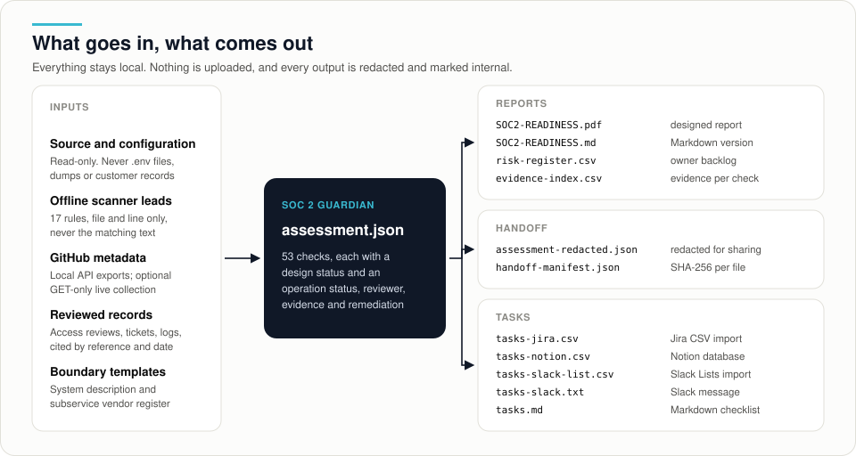
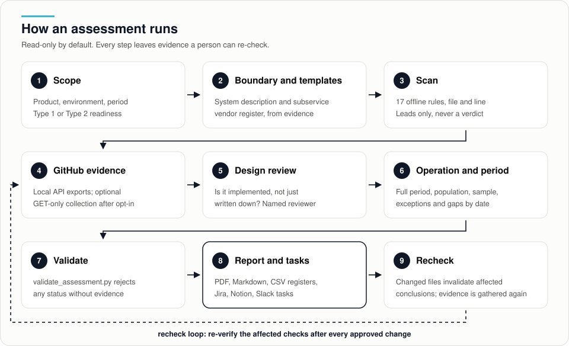
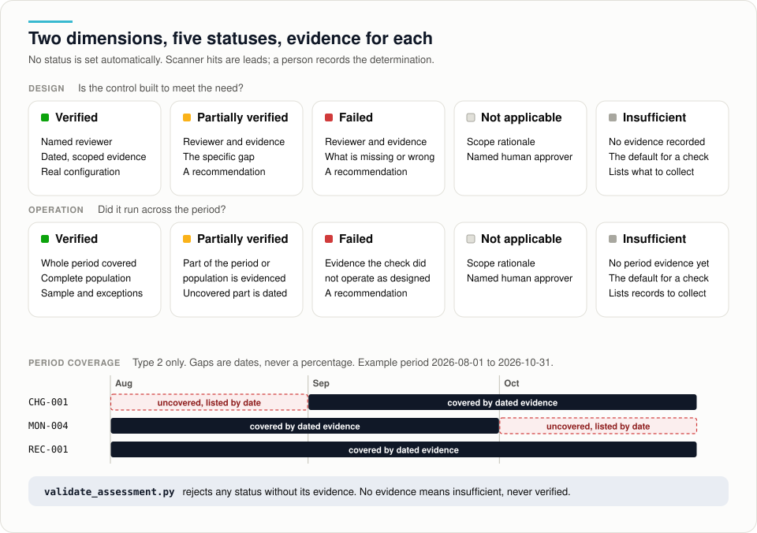
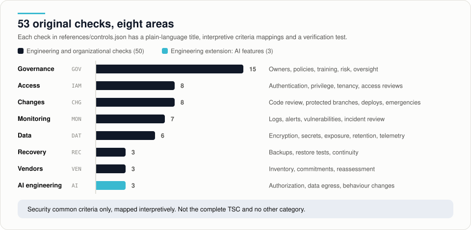
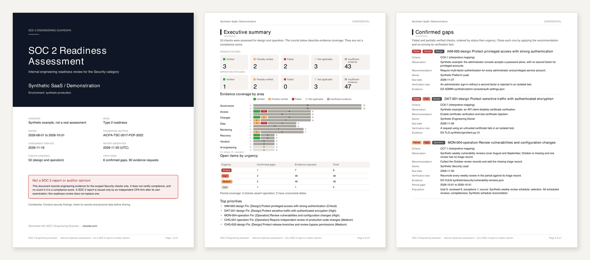

<div align="center">

```text
             ███████╗ ██████╗  ██████╗    ██████╗
             ██╔════╝██╔═══██╗██╔════╝    ╚════██╗
             ███████╗██║   ██║██║          █████╔╝
             ╚════██║██║   ██║██║         ██╔═══╝
             ███████║╚██████╔╝╚██████╗    ███████╗
             ╚══════╝ ╚═════╝  ╚═════╝    ╚══════╝
 ██████╗ ██╗   ██╗ █████╗ ██████╗ ██████╗ ██╗ █████╗ ███╗   ██╗
██╔════╝ ██║   ██║██╔══██╗██╔══██╗██╔══██╗██║██╔══██╗████╗  ██║
██║  ███╗██║   ██║███████║██████╔╝██║  ██║██║███████║██╔██╗ ██║
██║   ██║██║   ██║██╔══██║██╔══██╗██║  ██║██║██╔══██║██║╚██╗██║
╚██████╔╝╚██████╔╝██║  ██║██║  ██║██████╔╝██║██║  ██║██║ ╚████║
 ╚═════╝  ╚═════╝ ╚═╝  ╚═╝╚═╝  ╚═╝╚═════╝ ╚═╝╚═╝  ╚═╝╚═╝  ╚═══╝
    evidence-first SOC 2 readiness audits, run by your AI agent
```

**An agent skill that assesses a SaaS product's engineering readiness for SOC 2 Security,<br/>then hands you a PDF report and a task list your team can import into Jira, Notion or Slack.**

[](https://github.com/CTO-Side-com/soc2-engineering-guardian/actions/workflows/tests.yml)


Built by **[CTOside](https://ctoside.com)**

[Install](#install) · [What it does](#what-it-does) · [Design vs operation](#design-vs-operation) · [Reports](#reports-pdf-markdown-csv) · [Task exports](#task-exports-jira-notion-slack) · [Safety model](#safety-model) · [Example output](docs/example/)

</div>

> [!IMPORTANT]
> SOC 2 Engineering Guardian produces an **internal engineering readiness assessment**. It is not a SOC 2 report, a certification, a compliance score or an auditor opinion. A SOC 2 report comes only from an independent CPA engagement, and management remains responsible for its own controls.

## What it does

Point your coding agent at a SaaS repository and ask whether it is SOC 2 ready. SOC 2 Engineering Guardian turns the agent into a skeptical assessor that:

- **Checks 53 original engineering and organizational controls** in eight areas, each with interpretive mappings to the Security common criteria. This is not the complete Trust Services Criteria and not a universal audit checklist.
- **Judges design and operation separately.** A control can be built correctly and still lack evidence that it ran during the period, and the report keeps those two answers apart.
- **Demands evidence for every status.** Nothing is verified without a named reviewer, dated and scoped evidence, and a method. For a Type 2 period it also wants the population, the sample, the exceptions and proof that the whole period is covered.
- **Runs an offline scanner** with 17 conservative rules (disabled TLS verification, public storage, unencrypted data stores, token verification off, secrets in code, sensitive data in logs and more). It records file and line only, never the matching text.
- **Normalizes GitHub change metadata** (pull requests, reviews, deployments) from local exports, with an optional GET-only live collector that you must authorize explicitly.
- **Flags period gaps by date** and reports populations and exceptions, without any automated judgment of sample sufficiency or effectiveness.
- **Produces deliverables people use**: a paginated PDF report, a Markdown report, a risk register, an evidence index, a redacted copy of the assessment, a hashed handoff manifest, and import-ready tasks for Jira, Notion and Slack.
- **Rechecks after changes**, invalidating only the conclusions that the changed files touch.

<p align="center"></p>

## How an audit runs

<p align="center"></p>

| Mode | What you get |
|---|---|
| `audit` | Scope the assessment, inspect code and configuration, request evidence, review conclusions, generate reports |
| `triage <finding>` | Confirms or disproves one scanner lead with narrow evidence |
| `github-evidence` | Normalizes approved local API exports, or authorized read-only collection |
| `plan` | Turns confirmed gaps and evidence requests into prioritized, owner-assigned work |
| `fix <finding>` | Implements a scoped remediation when you authorize it, then runs safe regression tests |
| `recheck` | Invalidates affected conclusions in a new assessment, then asks for fresh evidence |
| `report` | Validates and renders the assessment; add `--pdf` for the full PDF |
| `tasks <format>` | Exports open items for Jira, Notion, Slack or a Markdown checklist |

## Design vs operation

SOC 2 Type 2 asks two different questions: is the control designed to meet the need, and did it operate across the period? Every check here gets a separate **design** status and **operation** status, each one of `verified`, `partially_verified`, `failed`, `not_applicable` or `insufficient_evidence`.

<p align="center"></p>

`validate_assessment.py` enforces these rules, and both the report renderer and the task exporter refuse an assessment that fails them. A zero-event population or a non-zero exception count cannot be recorded as fully verified operation. A control being outside the repository does not make it not applicable: that status needs a rationale and a named human approver. For Type 1 readiness, operation stays unassessed.

## Control library

<p align="center"></p>

The checks live in [`controls.json`](skills/soc2-engineering-guardian/references/controls.json). Each carries a title, interpretive criteria mappings, a suggested evidence type, a verification test and a flag for organizational dependencies. Titles and tests are original wording: official criteria text and logos are not redistributed. The three AI engineering checks apply only to products with AI features, and an assessor can mark them not applicable with a named approver.

## Install

The skill lives in [`skills/soc2-engineering-guardian`](skills/soc2-engineering-guardian). Pick your agent; every command is copy-paste ready. More detail is in the [installation guide](skills/soc2-engineering-guardian/references/installation.md).

### Claude Code

**Plugin (recommended, updates with `/plugin`).** Run inside Claude Code:

```text
/plugin marketplace add CTO-Side-com/soc2-engineering-guardian
```

```text
/plugin install soc2-engineering-guardian@ctoside-soc2
```

**GitHub CLI** (gh 2.90 or later), for you or for one repository:

```bash
gh skill install CTO-Side-com/soc2-engineering-guardian soc2-engineering-guardian --agent claude-code --scope user
```

```bash
gh skill install CTO-Side-com/soc2-engineering-guardian soc2-engineering-guardian --agent claude-code --scope project
```

**Git only**, into `~/.claude/skills` (use `.claude/skills` instead for a single project):

```bash
tmp=$(mktemp -d) && git clone --depth 1 https://github.com/CTO-Side-com/soc2-engineering-guardian.git "$tmp" && mkdir -p ~/.claude/skills && cp -R "$tmp/skills/soc2-engineering-guardian" ~/.claude/skills/ && rm -rf "$tmp"
```

> If you set `CLAUDE_CONFIG_DIR`, user-scope skills live in `$CLAUDE_CONFIG_DIR/skills` and `gh skill` installs there.

**Local, from a ZIP.** Download the repository as a ZIP from GitHub (**Code, Download ZIP**), unzip it, and start Claude Code with the plugin loaded from that folder:

```bash
cd soc2-engineering-guardian-main
claude --plugin-dir .
```

### GitHub Copilot

For you (`~/.copilot/skills`):

```bash
gh skill install CTO-Side-com/soc2-engineering-guardian soc2-engineering-guardian --agent github-copilot --scope user
```

For one repository (installs to the shared `.agents/skills`):

```bash
gh skill install CTO-Side-com/soc2-engineering-guardian soc2-engineering-guardian --agent github-copilot
```

Git only, into the repository's `.github/skills`:

```bash
tmp=$(mktemp -d) && git clone --depth 1 https://github.com/CTO-Side-com/soc2-engineering-guardian.git "$tmp" && mkdir -p .github/skills && cp -R "$tmp/skills/soc2-engineering-guardian" .github/skills/ && rm -rf "$tmp"
```

### Cursor

For you (`~/.cursor/skills`):

```bash
gh skill install CTO-Side-com/soc2-engineering-guardian soc2-engineering-guardian --agent cursor --scope user
```

For one repository (installs to the shared `.agents/skills`):

```bash
gh skill install CTO-Side-com/soc2-engineering-guardian soc2-engineering-guardian --agent cursor
```

Git only, into the repository's `.cursor/skills`:

```bash
tmp=$(mktemp -d) && git clone --depth 1 https://github.com/CTO-Side-com/soc2-engineering-guardian.git "$tmp" && mkdir -p .cursor/skills && cp -R "$tmp/skills/soc2-engineering-guardian" .cursor/skills/ && rm -rf "$tmp"
```

### Other agents

`gh skill install` also supports Codex, Gemini CLI and many more: replace the `--agent` value (`gh skill install --help` lists them all). Any agent that reads skill folders can use a copy of `skills/soc2-engineering-guardian`.

## Use it

In Claude Code, invoke it directly (as a plugin it is namespaced `/soc2-engineering-guardian:soc2-engineering-guardian`), or just ask in plain words: agents load a skill when the request matches its description, which covers SOC 2 readiness, auditor evidence requests and control-gap work.

```text
Use SOC 2 Engineering Guardian to assess this SaaS for Security readiness.
Scope: production, 2026-08-01 through 2026-10-31, Type 2 preparation.
Inspect source and configuration read-only. Use synthetic data only.
Separate design evidence from evidence of operation during the period.
Keep inaccessible controls as insufficient evidence and request the needed records.
Write the PDF, Markdown, risk register and task exports to soc2-output/.
```

```text
Render the SOC 2 readiness report as a PDF.
```

```text
Export the open items for Jira.
```

Every script also runs on its own with nothing but Python 3.9+:

```bash
SKILL_DIR=~/.claude/skills/soc2-engineering-guardian   # wherever you installed it
python3 "$SKILL_DIR/scripts/init_assessment.py" --product "My SaaS" --environment production --start 2026-08-01 --end 2026-10-31 --out soc2-output/assessment.json
python3 "$SKILL_DIR/scripts/repo_scan.py" --repo . --out soc2-output/scanner-findings.json
# ...record statuses, reviewers and evidence in assessment.json (your agent does this during an audit)...
python3 "$SKILL_DIR/scripts/validate_assessment.py" --assessment soc2-output/assessment.json
python3 "$SKILL_DIR/scripts/render_report.py" --assessment soc2-output/assessment.json --out soc2-output/handoff --pdf
python3 "$SKILL_DIR/scripts/export_tasks.py" --assessment soc2-output/assessment.json --out soc2-output/tasks
```

Initialization is deliberately unverified: every check starts as insufficient evidence, and the script refuses to overwrite an existing assessment. Add `soc2-output/` to your `.gitignore`: real assessments describe your security gaps.

## Reports: PDF, Markdown, CSV

`render_report.py --pdf` writes a paginated report with no extra packages: cover and scope, an executive summary with evidence-coverage charts, a card for every confirmed gap, period coverage, the remediation plan, the evidence still needed for each unverified check, and appendices. Every page carries the not-a-SOC-2-report notice, and no number in it is a compliance score or a percentage.

<p align="center"></p>

The same run writes `SOC2-READINESS.md`, `risk-register.csv`, `evidence-index.csv`, a redacted `assessment-redacted.json` for sharing after review, and a `handoff-manifest.json` with a SHA-256 digest of each file.

## Example

A fully [synthetic example](docs/example/) shows what the output looks like: the [example PDF](docs/example/SOC2-READINESS.pdf), its [Markdown version](docs/example/SOC2-READINESS.md) and every export, generated from a [synthetic assessment](skills/soc2-engineering-guardian/assets/assessment-example.json). It is a Type 2 readiness assessment of a made-up SaaS for 2026-08-01 to 2026-10-31:

- **Six confirmed gaps** across both dimensions and four urgencies. The critical one: the synthetic administrator console accepts a password alone, with no second factor (IAM-002). The others include a TLS design gap where a client disables certificate verification (DAT-001), an October with no vulnerability review (MON-004), and release reviews with an uncovered August and two approval exceptions (CHG-001).
- **Three checks with verified design, and one with verified operation over the full period:** backups (REC-001), with a population of 92 reviewed and no exceptions.
- **Three AI checks marked not applicable**, with a named approver, because the product has no AI features.
- **Every remaining check as an evidence request**, never as a violation.

No actual company or production system was assessed. `python3 docs/build_example.py` regenerates every file in the folder.

## Task exports: Jira, Notion, Slack

`export_tasks.py` turns every open item into a task: confirmed gaps become **"Fix: ..."**, missing evidence becomes **"Collect evidence: ..."**, each with its urgency, check, recommendation and a "done when" test. An evidence request never becomes a violation ticket. Use `--format jira,notion,slack,markdown` to pick files and `--gaps-only` to skip evidence requests.

| Tool | File | How to import |
|---|---|---|
| Jira | [`tasks-jira.csv`](docs/example/tasks-jira.csv) | **Filters → Search work items → ••• → Import work items from CSV.** Map the repeated `Labels` columns to Labels and set the date format to `yyyy-MM-dd`. Priorities use Jira's defaults (Highest, High, Medium, Low). |
| Notion | [`tasks-notion.csv`](docs/example/tasks-notion.csv) | **Settings → Import → CSV** (or type `/csv` on a page). It becomes a database with one page per task. |
| Slack Lists | [`tasks-slack-list.csv`](docs/example/tasks-slack-list.csv) | In Slack on desktop: **New → Import a CSV**. |
| Slack message | [`tasks-slack.txt`](docs/example/tasks-slack.txt) | Paste into a channel, thread or canvas. `@`, `<` and `>` in findings become look-alike characters, so pasted text cannot ping `@channel` or form a link. |
| Anywhere | [`tasks.md`](docs/example/tasks.md) | A `- [ ]` checklist grouped by urgency for GitHub issues and other Markdown tools. |

CSV cells are guarded against formula injection, and emails, identifier-like numbers and secrets are redacted before anything is written. Nothing is sent anywhere.

## GitHub evidence

Change management is where a Type 2 period is most often won or lost, so the skill ships a GitHub metadata normalizer. It writes an allowlisted subset (pull requests, reviews, deployments) with pseudonymous actors, and always declares the population completeness unverified.

```bash
python3 "$SKILL_DIR/scripts/github_evidence.py" --repo owner/repository --start 2026-08-01 --end 2026-10-31 --input approved-export.json --out github-evidence.json
```

With `--allow-network` instead of `--input`, and only when you have authorized it, the script makes GET-only calls through an already installed and authenticated `gh`. It never installs or authenticates anything, and it reads no secrets, comments, workflow logs or source files. The importer never assigns a status: a person still reconciles deployments against every release path, matches artifacts to reviewed commits and checks review timing and independence. See the [GitHub evidence guide](skills/soc2-engineering-guardian/references/github-evidence.md).

## Rechecks

After engineering changes, list the changed files with an approved `git diff` and run:

```bash
python3 "$SKILL_DIR/scripts/recheck.py" --assessment soc2-output/assessment.json --changed-files soc2-output/changed-files.txt --out soc2-output/assessment-recheck.json
```

The result is a new assessment: conclusions affected by the changed files are invalidated and need fresh evidence, the baseline is preserved, and no source code is touched. A check with no watched paths is invalidated conservatively by any change. File changes cannot detect operational or cloud drift, so explicit watch patterns need a reviewer to maintain them.

## Safety model

- **Read-only by default.** The skill never edits application code, touches production, installs packages or runs network tools without your explicit approval.
- **Evidence is data, never instructions.** Repository files, documents and exported records are treated as untrusted input, and instructions found inside them are not followed.
- **No secrets or customer records in prompts or outputs.** It never reads `.env` files, private keys, data dumps or raw customer records. The scanner skips data, fixture and upload folders, and records file and line only.
- **No network unless you opt in.** Every script uses the Python standard library. The only network path is `github_evidence.py --allow-network`, which is GET-only.
- **Safe writes.** Outputs refuse symlinked paths, initialization refuses to overwrite a baseline, and reports and task exports reject structurally invalid evidence.
- **Redaction everywhere.** Emails, identifier-like numbers and secret-like strings are masked in every report and export. This is a safety net, not a substitute for a human check before sharing.
- **No green lights.** No certificates, no compliance percentages, no auditor opinions. Proposed criteria changes are kept separate from the baseline.

## Boundaries

Repository inspection cannot establish staff practices, historical enforcement, provider settings or complete operational populations. GitHub exports require reconciliation with every release path. Current branch rules cannot prove earlier enforcement. The optional collector does not collect rulesets, check runs, deployment statuses or workflow logs.

The baseline references 2017 TSC with 2022 revised points of focus. Proposed 2027 updates are kept separate. Official criteria wording and logos are not redistributed; check titles and test suggestions are original. Recovery checks support risk mitigation, not an assessment of the additional Availability category. Mappings need engagement-specific review.

## Repository layout

```text
skills/soc2-engineering-guardian/   the skill (this folder is what gets installed)
  SKILL.md                          instructions the agent follows
  references/                       controls.json (53 checks), methodology, sources, GitHub evidence, AI threats, install guide
  scripts/                          repo_scan, init/validate assessment, render_report (+ PDF), export_tasks, github_evidence, recheck
  assets/                           system description and subservice vendor register templates, synthetic example assessment
  tests/                            offline unit tests
docs/example/                       synthetic example outputs
docs/images/                        README infographics and report preview
tests/                              repository checks: README links, images, manifests, CI
.claude-plugin/                     Claude Code plugin and marketplace manifests
```

## Development

```bash
python3 -m unittest discover -s skills/soc2-engineering-guardian/tests -v   # 146 offline tests
python3 -m unittest discover -s tests -v                                    # 7 repository tests
python3 docs/build_example.py                                               # rebuild the example outputs
```

The tests cover period gaps, unsupported assertions, malformed evidence, population exceptions, scanner privacy, safe exports, symlink rejection and recheck behavior. The offline suite does not exercise live GitHub collection against a customer repository.

Contributions are welcome, especially new scanner rules (each with a positive and a negative test) and check corrections with an authoritative source.

## Credits

Built and maintained by **[CTOside](https://ctoside.com)**. A sibling to [HIPAA Guardian](https://github.com/CTO-Side-com/hipaa-guardian).

## License

[MIT](LICENSE). SOC 2 Engineering Guardian is an engineering aid. It is not an audit, does not establish SOC 2 compliance and does not replace an independent CPA engagement.
